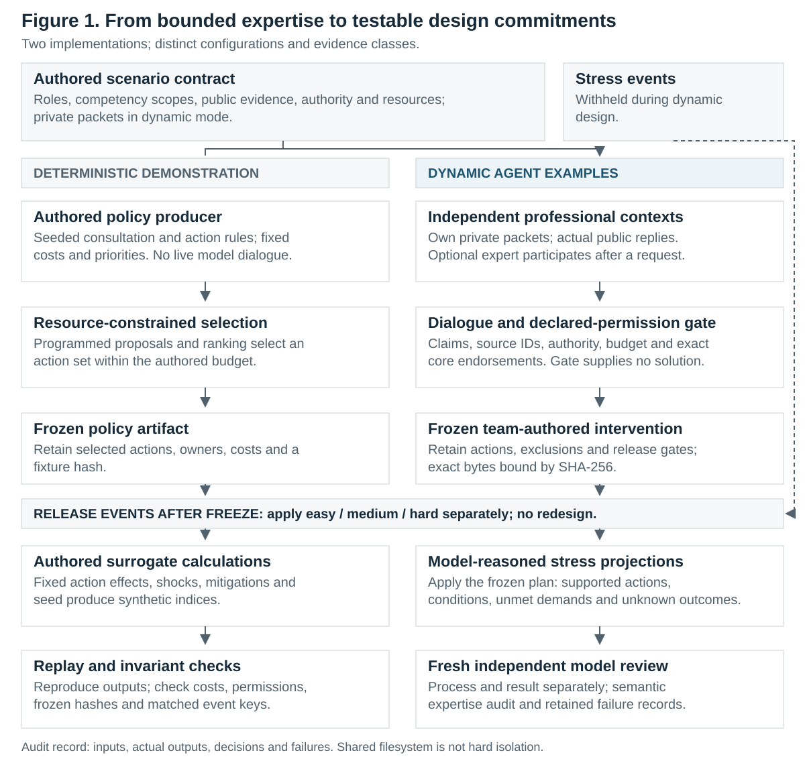
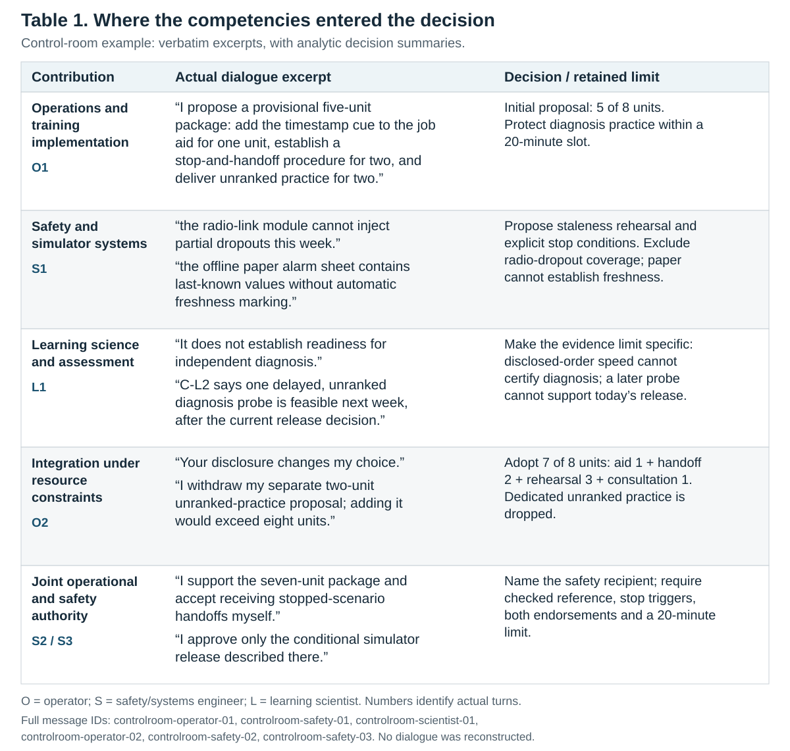
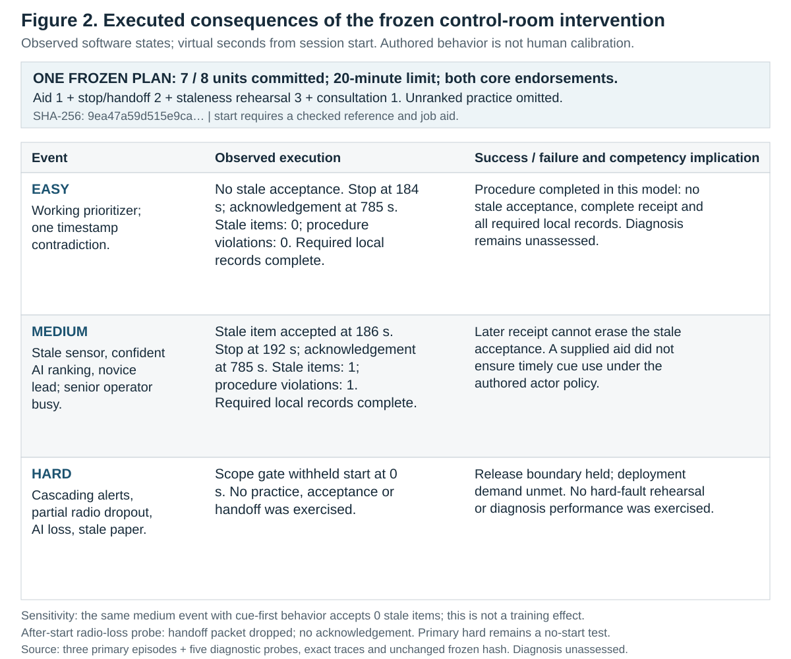

# Competency Mediation in Learning Engineering: From Expert Dialogue to Executable Deployment Tests

**Working manuscript · revised 4 November 2026.** Authors and affiliations require coauthor confirmation.

## Abstract

Learning engineering requires identifying the competencies a problem demands and integrating them into a feasible intervention. We present two linked contributions: a simulator for tracing bounded expert contributions into design commitments, and an executable deployment environment for observing what the frozen intervention actually does in a synthetic world. A deterministic policy demonstration verifies a reproducible contract; three dynamic examples retain actual professional-role dialogue and decisions. The control-room example integrates operational training, safety/systems expertise and learning-science advice into a seven-unit plan. We bind its unchanged artifact to an explicit clause-to-rule adapter and execute easy, medium and hard conditions. Easy prevents stale-data acceptance and completes handoff; medium accepts one stale item before its later stop; hard refuses an out-of-scope start and leaves deployment demand unmet. Five diagnostic probes expose dependencies on cue use, checked references and reachable recipients. These are observed software transitions under authored, uncalibrated behavior and environment assumptions, not measured human performance. The paired contributions make competency requirements and coordination dependencies inspectable while preserving the distinction between learning evidence and procedural success. They support teaching interdisciplinary judgment and investigating individual coverage versus collective integration; they do not establish team superiority or a causal training effect.

**Keywords:** learning engineering; competency mediation; interdisciplinary design; agent simulation; professional education; scenario-based research.

## 1. Thesis and significance for learning engineering

A design team may know that learners need practice, that a system has unsafe failure modes, and that operations cannot spare another shift. The difficult work is deciding what those contributions mean together: what to build, what to omit, what evidence is required, and when an intervention can be released. A useful account of learning engineering must make those decisions visible.

**Our thesis is that needed competencies are defined by the demands of a learning-and-performance system and become consequential through their integration into design decisions. Linking bounded expert dialogue to executable tests of the frozen intervention makes those requirements and coordination dependencies inspectable, including what an individual must cover and what a team must integrate.** The empirical demonstration concerns generated design decisions and executed software behavior, rather than a measured effect of professional identity or team size.

This argument integrates two perspectives. Learning research distinguishes performance during practice from durable learning and transfer ([Soderstrom & Bjork, 2015](https://doi.org/10.1177/1745691615569000)). Systems thinking directs attention to control constraints and interactions across a sociotechnical system ([Leveson, 2012](https://mitpress.mit.edu/9780262016629/engineering-a-safer-world/)). Here those perspectives become testable requirements: what evidence would establish independent diagnosis, whether the reference is valid, whether the check precedes action, and whether a stopped operator can actually reach a recipient.

We distinguish **coverage**, the competencies accessible to a team; **utilization**, whether a contribution is elicited and influences a decision; and **integration**, how contributions are reconciled with one another and with organizational constraints. The learning engineering flower offers a nonexclusive vocabulary for considering disciplinary contributions ([Ali et al., 2025](https://doi.org/10.59668/2109.21837)). Competency mediation refers here to a traceable design process, not a statistically identified indirect effect.

The paper makes **two contributions**. First, the design simulator represents competencies, evidence, authority and resources separately and retains the contributions that shape a frozen intervention. Second, the executable deployment environment converts that unchanged design into state transitions, observed successes and failures, and trace-supported functional requirements. Together they give the LERN community a way to study both the mediation of expertise and the consequences of the resulting design.

### 1.1 Use cases: who can do what with the instrument?

**Professional preparation and studio teaching.** An instructor can give learners the conversation up to the freeze, ask which evidence changed the proposed intervention, and require a prediction about an unexpected event. Learners then compare that prediction with the executable event trace and identify the omitted competency contribution, resource tradeoff, or unsupported claim. The assessable product is a source-linked explanation or revised design rationale. A subsequent teaching study should test novel-case reasoning and delayed transfer; the current examples do not demonstrate a learning benefit.

**Research on interdisciplinary design.** A researcher can define a contribution episode—evidence disclosed, proposal challenged, commitment changed, consequence exposed—and code it consistently across runs. Role-specific knowledge, consultation availability, authority and resources provide manipulable conditions. Executable tests add concrete performance predicates and counterexamples to apparent sufficiency. The present examples support hypothesis formation and requirement diagnosis; they do not isolate causal effects of professions or competencies.

**Organizational design rehearsal.** A cross-functional team can use a scenario to surface unowned handoffs, assumptions about available staff, and evidence required before release. The output is a decision trail, an explicit release boundary, and an executable test of assumed dependencies. It can inform a subsequent real design review; it is not certification, an operational forecast, or a substitute for affected-person and domain-expert review.

## 2. Architecture: connect contributions to consequences

**Figure 1. Competency-mediation simulator architecture.** The deterministic path uses authored policies and produces synthetic indices. The dynamic path uses independent model contexts and actual professional dialogue. The frozen control-room design is then bound to a manually specified executable adapter and discrete-event environment. Each path applies three event levels to an unchanged design. The paths have distinct configurations and are not matched treatment groups. Gates validate declared evidence and authority; they do not supply missing expertise or a better intervention. Original process review and independent software validation remain separate. The deployed synthetic actors use authored reactive policies; they are not new design agents. Runtime assumptions were specified retrospectively and are explicit.

### 2.1 Represent the professional task

A scenario specifies the organizational problem, public evidence, available roles, resource limits, candidate responsibilities and deployment events. Dynamic participants additionally receive private evidence, explicit competencies and exclusions, decision rights, tools and availability. Competencies can overlap. A senior operator can implement training and interpret operational cues without certifying assessment validity; a service designer can apply a supplied fictional policy without acquiring unrestricted legal authority.

Only a participant's own packet and delivered public messages enter its assigned design context. A consultable specialist joins after an actual request and has a cost. A substantive claim must identify its evidence and whether it is a supplied fact, bounded professional judgment, attributed advice or hypothesis. Outside-scope advice must come from an actual consulted message. The gate checks declared scope, evidence identifiers, source messages, authority, resource arithmetic and exact endorsements. A separate semantic audit checks whether the language respects those declarations.

These are evidence and authority controls. They do not erase pretrained knowledge. The current native contexts share a filesystem; access is instruction-bounded and audited through tool records rather than enforced by separate operating-system sandboxes.

### 2.2 Freeze before testing

Participants propose, question and negotiate in natural professional language. Readable phase instructions organize dispatch without selecting the team's diagnosis or intervention. The team authors actions, owners, costs, rationale, source messages, acceptance tests, exclusions and release conditions. Core participants endorse the exact bytes or withhold endorsement. The dynamic implementation records the frozen artifact with SHA-256; the deterministic implementation retains a fixture hash. No substantive coordinator or hidden repair agent supplies the solution.

Easy, medium and hard conditions are applied separately to the same design. For the control-room intervention, the executable adapter binds all four purchased actions, actual dual endorsements, release scope and the twenty-minute allocation to a program. Its mapping names the exact frozen clauses; it is a manual formalization, not an automatic natural-language compiler or another professional who improves the plan. The deployment environment may inject a failure the original training simulator could not rehearse, without crediting the intervention with that unavailable capability.

The discrete-event world contains a display record, an authored local reference, a ranked-item queue, a synthetic actor's response schedule, radio and recipient availability, and a participant-owned console log. Events implement preparation, start checks, inspection, acceptance, stop, transmission, acknowledgement and recording. Every event records virtual time and before/after state in a hash chain. A separate observer derives success predicates from those transitions; it does not use difficulty or profession labels to select an outcome.

The outcome contract distinguishes stale-data acceptance, check-before-acceptance compliance, acknowledged complete handoff, required local records, scope adherence and deployment-demand fulfillment. No stale acceptance plus a completed required handoff can satisfy the exercised procedure while diagnosis remains unassessed. Correctly refusing a hard event can obey the release boundary while failing to deliver the demanded capability. No unfunded diagnosis or delayed-transfer assessment is silently added.

## 3. Demonstrations and evidence

### 3.1 Deterministic example: a reproducible instrument contract

The authored casebook contains logistics, public-benefits service and control-room settings, each with three illustrative configurations and four seeds: **36 designs and 108 stress applications**. Consultation, proposals, selection priorities, costs, action effects and surrogate outcomes follow programmed rules. Its dialogue-like records are authored templates, with zero live model calls.

Exact replay reproduced the retained output. Checks found no budget overspend, unauthorized or unavailable-expert actions, changed frozen artifacts, mismatched event keys, or missing event levels. These are software findings. An informative negative case is that the benefits operations-lead and human-centered-lead configurations produce identical actions and outcomes when their procedures and priorities remain identical. A change of label alone does not implement a different collaborative process.

The deterministic example is useful for checking the contract and teaching how explicitly assumed rules lead to consequences. Its numerical indices are authored assumptions, not estimates of capability or evidence of disciplinary effects. They are not pooled with the dynamic results.

### 3.2 Dynamic examples: actual dialogue and bounded choices

The three focal design examples comprise **12 distinct subagent conversations**—two core roles, one requested consultant and one fresh process reviewer in each setting—and 21 public design utterances. Executable deployment episodes are separate software executions, not additional model-professional conversations. Runtime records identify `gpt-6.1-sol` with high reasoning effort. Task turns are not provider API-call counts. The original event descriptions were held out until design freeze. Executable runtime details were instantiated later; this is a retrospective model demonstration, not a prospectively blinded operational trial.

In **AI-assisted logistics**, an operations/training lead and analyst consult a learning scientist. The analyst discloses incompatible pre/post denominators and missing override annotations; the scientist supplies the limits of repeated examples and available assessment. The nine-of-ten-unit plan restricts practice to two workers and withholds release because coverage, attendance and assessor scheduling remain unconfirmed. The transcript shows how evidence changes the problem framing and the scope of the claim.

In **public-benefits service**, a director and service designer/policy steward consult an access practitioner. Their initial alternatives fund assistance or wording changes. Advice about interpreting hours and untested access helps resolve the allocation in favor of assistance, with wording confusion explicitly left unresolved. The nine-unit plan retains no release because authorized review capacity, handoff, recruitment and tested access remain unestablished. The policy steward's limited signoff does not create staff or validate access.

The **control-room example**, developed below, has the clearest explicit revision of a proposed intervention and a conditional release to test. It was selected for the inspectability of its contribution trail, not because it establishes the best outcome. Its operator and safety/simulator engineer consult a learning scientist, negotiate a seven-of-eight-unit intervention, and jointly constrain its release.

### 3.3 Separate process evidence from executable results

Original process reviewers traced evidence disclosure, actual consultation, resource and authority choices, unsupported specialist claims and freeze integrity. The three design examples passed bounded process feasibility. Those reviews did not observe execution and are not the executable outcome evidence reported below.

The control-room deployment evidence comprises three primary episodes and five diagnostic probes. Primary easy uses an authored cue-first response schedule; primary medium uses a ranking-first schedule. A same-medium cue-first probe tests that dependency. Other probes remove a reference or recipient, exercise a current-record control, and remove the radio channel after an existing stop. These are sensitivity and boundary checks, not replications of people or a factorial study. We report counts and virtual event times, not estimated probabilities or a training effect.

Unit/counterexample tests and an independent source audit check the adapter's clause fidelity, actual packet values, release checks, participant-owned records, state continuity and exact replay. Complete implementation/model snapshots and failed validation versions are retained separately. Outcome predicates and traces are authoritative; descriptive terminal labels and partial local summaries are not standalone success verdicts. The accepted eight-episode record has a scoped audit pass, not a proof of correctness for every input or calibration to a physical utility.

## 4. Worked example: how the control-room decision changed

The fictional utility has improved alarm acknowledgement times after adopting an AI prioritizer. The operator knows that novices usually follow the ranking, experienced operators use an undocumented timestamp cue, and only twenty minutes are available per operator. The safety engineer knows that sensor staleness can be injected but partial radio dropout cannot, and that paper fallback values have no automatic freshness marking. The learning scientist knows that the current acknowledgement exercise discloses the expected alarm order and that a delayed diagnosis probe would occur after the release decision.

### 4.1 Actual dialogue and the commitments it informed

**Table 1. Actual dialogue-to-decision trace.** Excerpts are verbatim selections from the retained seven-message conversation; the right column contains analytic summaries. O denotes the operator, S the safety/simulator engineer and L the learning scientist. The suffixes identify actual turns, for example O2 is `controlroom-operator-02`. The complete [dialogue](../../experiments/competency-live/2026-11-04/transcripts/controlroom.md) and [source-checked figure data](figures/competency-figure-sources.json) retain context and provenance. The learning scientist specifies the evidence limit within an already cautious discussion; the record does not show that the consultant originated that caution or was causally necessary.

The operator's initial five-unit proposal purchases a job aid, stop/handoff procedure and dedicated unranked practice. Safety proposes a different package: a sensor-staleness rehearsal, explicit freshness criteria, and consultation. The operational consequence of the exchange appears directly in O2:

> “Your disclosure changes my choice.”
>
> “I withdraw my separate two-unit unranked-practice proposal; adding it would exceed eight units.”

The replacement does not make the omitted learning need disappear. O2 retains concern that novice reliance on AI ranking receives no dedicated practice. The learning scientist adds a specific reason to separate acknowledgement from diagnosis—the expected order was disclosed—and explains why next week's probe cannot justify today's release. This advice refines the evidence requirements and is carried into the frozen limitations; it is not safety signoff.

The next safety reply turns an abstract instruction to “check freshness” into an explicit design commitment: prepare an authored event record, compare displayed values with the current scripted state, and stop for contradiction, older state, missing reference or indeterminate match. The engineer also accepts handoff receipt within the existing team. No independently verified clock, numerical freshness threshold, extra personnel or radio-failure capability is invented.

### 4.2 What was frozen

The final intervention commits **seven of eight units**: timestamp job aid (1), stop/handoff (2), staleness rehearsal and local logging (3), and the completed consultation (1). It assigns the twenty-minute slot to aid (3 minutes), rehearsal (10), handoff (5) and recording (2). Both core participants endorse the exact artifact. Start still requires the checked reference and job aid; either participant can stop. Paper values remain uncertain and cannot clear a stop. Dedicated unranked practice and a delayed probe are unfunded, and partial radio dropout is outside scope.

These commitments make the competency contributions consequential. Operational knowledge supplies the cue and feasible delivery structure; safety/systems expertise supplies the reference, recipient and stop conditions; learning science constrains the interpretation of performance; integration selects among incompatible uses of the budget. The trace supports that account of the design. It does not establish that this package is optimal.

### 4.3 Observed executable consequences: easy, medium and hard

**Figure 2. Executed deployment results.** The artifact remains `9ea47a59d515e9ca…`. Results come from the [retained executable episodes](../../experiments/competency-live/2026-11-04/controlroom-executable-v3/README.md), not the earlier written projections. Times are virtual seconds from session start. Actor timings, initial sensor values, channel availability and event schedules are authored and uncalibrated; the observations are real software execution, not human or utility performance.

**Easy—procedure completed in the instantiated model.** Preparation creates and checks the local reference and the realized job aid; practice starts at second 180. The cue-first actor compares at 184, detects the mismatch and stops. Its scheduled acceptance at 186 is suppressed. At 780 it sends the required handoff, including last-known value `9` explicitly labeled uncertain, timestamp `90`, discrepancy and stopped status. The recipient acknowledges at 785. Participant-owned comparison, stop, receipt and final observation records complete within the twenty-minute session. Zero stale items enter the next-step queue. This is success on the modeled containment/handoff obligation, not evidence of independent diagnosis.

**Medium—an error precedes later containment.** The ranking-first actor accepts one stale item at 186, before inspecting and stopping at 192. Its handoff is acknowledged at 785 and the required records complete, but neither action removes the earlier queue error or check-before-acceptance violation. The deployment obligation therefore fails. The same medium environment with the cue-first actor accepts zero stale items and completes the procedure. This contrast makes cue use a conditional requirement; because response timing was authored, it is not evidence that omitted practice caused the error or that another lesson would cure it.

**Hard—release compliance succeeds while deployment coverage fails.** Known cascading-alert, radio-dropout and AI-loss conditions fail the actual scope gate at second zero. No practice, acceptance or handoff begins. The code observes refusal, rather than granting a hypothetical recovery. The intervention obeys its boundary while leaving the combined deployment demand unmet; zero stale acceptances during no-start is not demonstrated hard-event capability.

The after-start hard probe tests a different boundary explicitly permitted by the frozen rules. The actor first stops at 184 for the initial contradiction. Radio loss at 190 then drops its scheduled handoff at 780. Radio restoration at 1085 does not invent a retry; acknowledgement remains absent. This is a communication-loss-after-stop result, not detection or diagnosis of emerging compound faults. A separate unavailable-recipient probe also prevents acknowledgement, while a missing-reference probe prevents start. The current-record control checks and accepts current data instead of rewarding an always-refuse policy.

### 4.4 From failure witnesses to needed competencies

These tests identify situated **functional requirements**, under the declared model, rather than infer competence from a title. Reference preparation/checking is a systems-verification requirement; acting on the cue before accepting data is an operational-performance requirement that calls for suitable practice and assessment; acknowledged delivery and local recording are coordination and infrastructure requirements. Combined-failure coverage remains a resource and system-design gap. The [dependency record](../../experiments/competency-live/2026-11-04/controlroom-executable-v3/competency-dependencies.json) links each interpretation to concrete trace witnesses.

The integration of learning research and systems thinking matters at exactly these boundaries. A correct stop does not establish learning or transfer. A well-designed practice objective cannot guarantee a working reference or reachable recipient. An error may originate in cue use, interface/workload conditions, communication or release scope; calling every failure a training deficit would discard the system explanation. Executable consequences help specify what evidence and capability are missing before choosing who should contribute or what intervention to fund.

## 5. Implications: individual coverage, collective integration and use

The relevant staffing question is **which required functions must be covered and how they will be integrated**. A suitably competent and authorized individual might cover several domains. A team can distribute those functions but must also manage interpretation, decision rights, workload and delivery across its handoffs. The control-room dialogue shows distributed contributions entering one design; the unavailable-recipient and radio-loss probes show that naming a colleague does not make coordination work. The current scenario also requires two approvals by authored rule. That administrative condition is not evidence that two people are cognitively necessary or that teams outperform individual experts. A matched individual-design comparison was not run.

For professional preparation, learners can predict whether O2's compromise is sufficient, execute the frozen plan, and explain why a later successful handoff does not erase an earlier error. Assessment can require a source-linked distinction between performance, diagnosis and learning, and between a competency gap and an unavailable system resource. Whether this improves learners' judgment or transfer remains an educational research question.

For researchers, the first contribution makes mediation observable at the level of a contribution episode; the second supplies executable predicates and failure witnesses. Together they support studying coverage, utilization and integration without treating role labels as the manipulation or fluent explanations as the outcome. Repeated cases and practitioner/affected-person review can test coding reliability, task realism and sensitivity before causal claims are pursued. An immediate factorial study is unnecessary.

For organizational rehearsal, an output is now both a decision trail and a testable account of its dependencies. A real design review can ask who can verify the reference, demonstrate uncued diagnosis, receive the handoff and authorize a broader release. Simulation-derived requirements remain conditional on the authored task model and need domain review before use in an actual organization.

## 6. Limits and conclusion

The executable environment is a small retrospective model of workflow and information validity, not utility physics, calibrated human behavior or a learning-gain model. The easy/medium contrast depends on authored response policies; behavior and condition differ in the primary episodes. Sensitivity probes expose that dependence but do not remove it. The manual clause-to-rule adapter requires semantic validation, and its scoped audit pass does not cover every possible transition. Diagnosis and delayed transfer are unassessed because the frozen intervention did not fund them. Written design dialogue is not a validated professional population ([Aher et al., 2023](https://proceedings.mlr.press/v202/aher23a.html)); model reviews can share biases ([Zheng et al., 2023](https://arxiv.org/abs/2306.05685)). Knowledge gates do not erase latent model knowledge or provide hard filesystem isolation.

Within those limits, the two contributions connect **expertise, design commitment and executable consequence**. The example establishes a concrete modeled requirement: the check must precede acceptance, the reference must be verifiable, and the recipient must actually be reachable. It also preserves the limits of success: procedural containment does not establish independent diagnosis, and refusing an out-of-scope demand does not deliver that capability. This is the instrument's value for learning engineering: making the competencies a problem demands, and the work of integrating them individually or collectively, inspectable and open to testing.

## Materials and AI use

The deterministic [specification](../../src/data/lifecycle/competency-casebook-v1.json), [runner](../../tools/lifecycle/competency_casebook_runner.mjs) and [retained observations](../../data/lifecycle/competency-casebook/observations-v1.json) define the programmed demonstration. Full focal dynamic dialogue is available for [logistics](../../experiments/competency-live/2026-11-04/transcripts/logistics-gated.md), [benefits](../../experiments/competency-live/2026-11-04/transcripts/benefits.md) and [control room](../../experiments/competency-live/2026-11-04/transcripts/controlroom.md). Role packets, native model provenance, exact endorsements, freezes, projections, independent reviews and failures are retained alongside those records. The [figure source manifest](figures/competency-figure-sources.json) binds selected quotations and executable results to retained source bytes. The [environment contract](../../src/data/lifecycle/controlroom-deployment-v2.json), [manual adapter](../../tools/lifecycle/controlroom_contract.py), [discrete-event engine](../../tools/lifecycle/controlroom_simulator.py), [observer](../../tools/lifecycle/controlroom_results.py) and [runner](../../tools/lifecycle/run_controlroom_deployment.py) define the second contribution. Exact code/model snapshots, complete traces, independent source audit and replay instructions accompany the accepted executable record.

AI assistance was used to prepare the instrument and manuscript. Dynamic dialogue and decisions were produced by actual independent model contexts; facts, professional scopes, costs and events were authored. Original projections and design reviews remain model-generated interpretations. Executable deployment actors are explicitly authored policies; they are not independent model professionals or observed people. No new design-agent episode was generated for these tests, and no human outcome, causal competency effect or team-superiority result is claimed.

## References

Aher, G. V., Arriaga, R. I., & Kalai, A. T. (2023). Using large language models to simulate multiple humans and replicate human subject studies. *Proceedings of Machine Learning Research, 202*, 337–371. https://proceedings.mlr.press/v202/aher23a.html

Ali, Z., Morehead, K., Jay, M., Arner, T., Lis, J., & Braitling, B. (2025). *Learning engineering is a team sport: Collaborative explorations for team building strategies with short scenarios in various contexts.* https://doi.org/10.59668/2109.21837

Leveson, N. G. (2012). *Engineering a safer world: Systems thinking applied to safety.* MIT Press. https://mitpress.mit.edu/9780262016629/engineering-a-safer-world/

Soderstrom, N. C., & Bjork, R. A. (2015). Learning versus performance: An integrative review. *Perspectives on Psychological Science, 10*(2), 176–199. https://doi.org/10.1177/1745691615569000

Zheng, L., et al. (2023). Judging LLM-as-a-judge with MT-Bench and Chatbot Arena. *Advances in Neural Information Processing Systems, 36*. https://arxiv.org/abs/2306.05685
