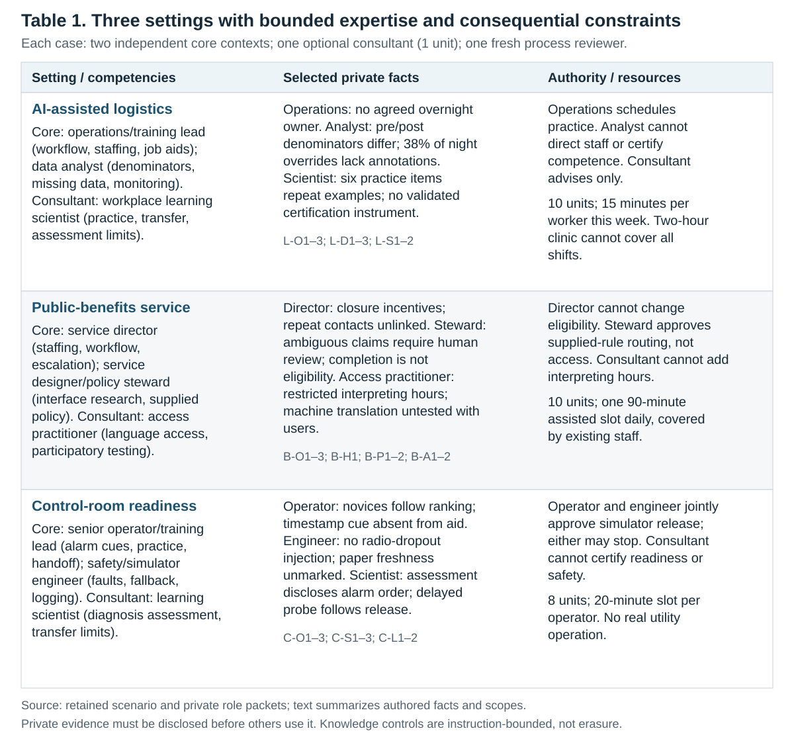
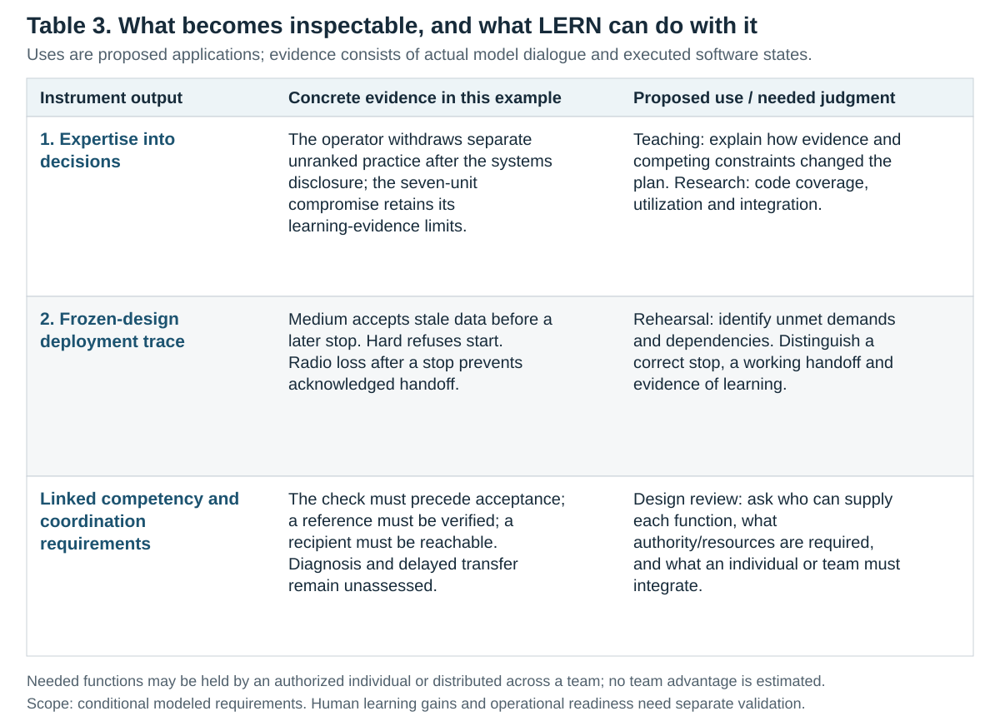

# Competency Mediation in Learning Engineering: From Expert Dialogue to Executable Deployment Tests

**Working manuscript · revised 4 November 2026.** Authors and affiliations require confirmation.

## Abstract

Who needs to know what when a team designs for learning and work? We describe two tools for examining that question. In the first, model agents receive different evidence, professional responsibilities and decision rights. Their conversations show which contributions change a design. We demonstrate this approach in logistics, public benefits and control-room training. The second tool runs a frozen design in a simulated work system. In the control-room case, checking the display first prevents stale-data acceptance. A second run accepts stale data before checking. A third run stops at the release boundary, leaving the demand unmet. These software runs show where the design depends on cue use, a checked reference and a reachable colleague. The records give instructors, researchers and design teams a way to examine how expertise shapes decisions and what people and systems need to do together.

**Keywords** · learning engineering, interdisciplinary teams, competency mediation, systems thinking, simulation, workplace learning

## 1. Introduction

A utility introduces an AI alarm prioritizer and operators acknowledge alarms faster. Are they ready to diagnose an unfamiliar alarm on their own? In our fictional case, the practice exercise tells them the expected order. A faster acknowledgement under those conditions leaves open whether they can recognize a problem when the ranking is wrong. Even an operator who knows when to stop needs a way to reach the person responsible for the handoff.

Learning research distinguishes performance during practice from retention and transfer (Soderstrom & Bjork, 2015). Systems thinking asks how the work depends on tools, information and the actions of other people (Leveson, 2012). A learning engineer needs both views to decide what people should practice, what the system must provide and what evidence would justify release. **Our thesis is that the work and its conditions should determine which competencies a learning engineering team needs. We can examine how those competencies matter by tracing who changed a design decision and then testing what the design does under stated conditions.**

The learning engineering flower offers a starting vocabulary for assembling a team around a problem (Ali et al., 2025). One person can cover several functions. A team can bring together people who hold different evidence, challenge each other's assumptions and commit resources across areas of responsibility. We distinguish *coverage* (whose expertise and evidence are available), *use* (which contributions enter a decision) and *integration* (how the team resolves tradeoffs and assigns responsibility). We call this work of bringing expertise to bear on decisions *competency mediation*.

We ask two questions:

1. Which contributions change the proposed intervention or the conditions under which the team will release it?
2. When the frozen intervention runs under different conditions, where does it work, where does it fail and what functions do those results suggest the design needs?

Our first contribution is a design simulator that records how model agents with bounded expertise and authority reach a decision. Our second is a deployment simulator that executes the frozen design and records what happens. The design record is useful for studying collaboration. The execution record lets a reader test a claim about the resulting design, such as whether a stop procedure still works when the recipient is unavailable.

## 2. Methods

**Figure 1. Design and deployment workflow.** The deterministic casebook uses programmed policies and produces synthetic indices. Model agents generate the design dialogue in the other path. A separate discrete-event program runs the frozen control-room intervention under specified conditions.

### 2.1 Scenario design and collaboration

Each scenario specifies a workplace problem, a common briefing, private role packets, authority, available time, costs and events for later testing. Competencies can overlap. The operator can plan practice and interpret cues. The safety engineer can set release conditions. A learning scientist can advise on what the exercise measures. Table 1 shows the three teams and what each participant has to work with.

**Table 1. Scenario setup.** Each case has two core design participants, an optional consultant and a separate process reviewer. The consultant joins on request and costs one unit. The table summarizes the role packets. [Role packets and figure sources](figures/competency-figure-sources.json).

The focal examples used 12 distinct subagent conversations and produced 21 public design messages. In each case the two core agents and a requested consultant spoke from separate model contexts. A fourth agent reviewed the design process. The runtime records identify `gpt-6.1-sol` with high reasoning effort.

A participant receives its own packet and the public messages delivered to it. It attributes substantive claims to supplied evidence, professional judgment within its scope, advice from a consulted role or a hypothesis. The software checks evidence identifiers, declared scope, authority, costs and endorsements. A process reviewer reads the record for unsupported claims and checks whether the parties disclosed the evidence they relied on. Packet access is governed by instructions and tool records in a shared filesystem. The protocol limits the information supplied to a role and leaves the model's pretrained knowledge in place.

The agents propose actions, ask questions and settle who will do what. The core roles must endorse the same version of the intervention before it is frozen. The freeze records actions, owners, costs, acceptance tests, exclusions and release conditions and identifies the artifact by SHA-256. The agents see the event descriptions after the freeze. Coordination is limited to routing and protocol checks. The design decisions come from the participants.

We also ran a deterministic casebook across the three settings, with three configurations and four seeds per setting. Its programmed consultation, selection and stress rules produced 36 designs and 108 stress applications. The casebook uses templates for its dialogue records and makes zero live model calls. It provides a reproducible check of the design and test procedure.

### 2.2 Executing the frozen intervention

We selected the control-room case because the transcript records a specific change of mind and ends with a conditional release. We then specified the deployment model and manually mapped the frozen clauses to executable rules. The mapping retains the four purchased actions, the twenty-minute slot, both approvals and the release boundary. The deployment model can expose the plan to communication failures that the intervention's training simulator could not rehearse.

Each run starts from the same design. The discrete-event model schedules preparation, inspection, acceptance, stopping, transmission, acknowledgement and recording. A display, a local reference, a ranked queue and a radio channel can change state. The model logs the time and state before and after each event. An observer checks whether the actor accepted stale data or acted before checking, whether a complete handoff arrived and was acknowledged, whether the required records were kept and whether the run met the release conditions and deployment demand.

We ran easy, medium and hard conditions and five probes. The primary easy actor checks the cue first. The primary medium actor follows the ranking first. A second medium run changes the response schedule to check the cue first. Other probes remove the reference, remove the recipient, interrupt radio service after a stop or supply a current record. The schedules and sensor values are specified inputs. We report counts and virtual event times. Software tests and a separate audit check the mapping to frozen clauses, packet contents, event traces and replay. [Execution record and audit](../../experiments/competency-live/2026-11-04/controlroom-executable-v3/README.md).

## 3. Results

### 3.1 What the design records show

The deterministic casebook reproduced its outputs exactly. The checks passed for budget, authority, expert availability, frozen identity and event matching. In the benefits example, changing the lead's label while holding procedures and priorities fixed produced identical actions and outcomes.

The process reviews found the three focal designs feasible within the declared rules. In **logistics**, the analyst found that the before and after measures had different denominators and that override annotations were missing. A learning scientist explained the limits of the proposed assessment. The plan committed nine of ten units, restricted practice to two workers and withheld release pending confirmation of attendance, coverage and assessor availability. In **public benefits**, information about interpreting hours and access helped the team choose assisted service over rewriting confusing language. The nine-unit design left the wording problem open and withheld release pending authorized review capacity, handoff, recruitment and access testing. [Logistics dialogue](../../experiments/competency-live/2026-11-04/transcripts/logistics-gated.md) · [Benefits dialogue](../../experiments/competency-live/2026-11-04/transcripts/benefits.md).

### 3.2 How the control-room proposal changed

The operator initially proposed a job aid, a stop and handoff procedure, and practice without the AI ranking. The safety engineer proposed rehearsing a stale reading and checking it against a reference. Paper fallback values carried no freshness marking, and the training simulator could not rehearse partial radio dropout. The operator, responding to that disclosure, wrote:

> “Your disclosure changes my choice.”
>
> “I withdraw my separate two-unit unranked-practice proposal; adding it would exceed eight units.”

The learning scientist pointed to a specific problem with the existing exercise. It gave away the expected order, and the delayed diagnosis probe would come after the release decision. The operator's concern about reliance on the ranking remained open. The safety engineer specified when to stop and took responsibility for receiving the handoff.

**Table 2. Contributions and design decisions.** The excerpts come from the seven-message control-room conversation. The right column describes how the contributions informed the design. [Full dialogue](../../experiments/competency-live/2026-11-04/transcripts/controlroom.md) · [Figure sources](figures/competency-figure-sources.json).

The two core participants endorsed a seven-unit design: one for the timestamp job aid, two for stopping and handing off, three for staleness rehearsal and local logging, and one for the consultation. Of twenty minutes, they allocated three to the job aid, ten to rehearsal, five to handoff and two to recording. Start requires a checked reference and job aid. Either role can stop on a contradiction, an older state, a missing reference or an indeterminate match. The paper fallback remains uncertain and cannot clear a stop. The budget left dedicated unranked practice and the delayed probe unfunded. The release covered sensor staleness and excluded partial radio dropout.

### 3.3 What happened when the design ran

**Figure 2. Deployment tests.** Each primary run used the same frozen artifact (`9ea47a59d515e9ca…`). Times are virtual seconds from the start of the session. [Traces and results](../../experiments/competency-live/2026-11-04/controlroom-executable-v3/README.md).

**Easy.** Practice begins at second 180. The actor checks the display at 184, detects the mismatch and stops before the scheduled acceptance at 186. The handoff at 780 includes the last-known value of 9 marked uncertain, timestamp 90, the discrepancy and the stop status. The recipient acknowledges at 785 and the required records are completed. Zero stale items enter the queue.

**Medium.** The actor accepts a stale item at 186 and stops after checking at 192. The recipient acknowledges at 785 and the actor completes the records. The stale item has already entered the queue. In the probe that holds the medium environment fixed and changes the order of response, the actor checks first, accepts zero stale items and completes the procedure.

**Hard.** The known combination of cascading alerts, radio dropout and AI loss exceeds the permitted scope. The release check refuses start at second zero. It enforces the boundary and leaves the deployment demand unmet.

In the probe where the compound fault emerges after start, the actor has already stopped at 184 for the initial contradiction. The radio goes down at 190, so the handoff sent at 780 is dropped. Service returns at 1085, after the handoff slot, and the handoff remains unacknowledged. Removing the recipient also prevents acknowledgement. Removing the reference prevents start. With a current reference and display, the actor checks the record and accepts it. [Probe results and dependencies](../../experiments/competency-live/2026-11-04/controlroom-executable-v3/competency-dependencies.json).

## 4. Discussion

Which part of the problem should the team address next? The medium run shows why the timing of the check matters. The radio probe shows why the recipient and channel belong in the design. The easy run shows successful containment and handoff under its stated conditions. To assess independent diagnosis, the team would need to observe an operator working through a case without the expected order. To assess transfer, it could use a different case after a delay. The design review can ask whether to change what operators practice, how the display presents freshness, who receives the handoff or when the intervention can be released.

This case shows what collaboration adds to the initial proposal. The operator brings the cue and a feasible way to practice. The engineer explains the simulator's limits and turns “check freshness” into a procedure with a reference, a stop condition and a recipient. The learning scientist helps specify what the available exercise can support. The team works out which of these provisions it can fund and who will act. An individual with the requisite expertise, evidence and authority could cover several functions. The study examines how this team arrived at its design. A comparison of team and individual designs would require matched tasks and conditions.

**Table 3. Applications for learning engineering.** The design record shows what changed in the plan. The deployment record lets readers examine why the plan met or missed a demand. The table connects those records to proposed uses in teaching, research and design review.

An instructor can give learners the dialogue up to the decision, ask them which tradeoff they would make and have them explain the resulting run. Researchers can examine which evidence entered a choice and whether an apparent competency gap depends on the system conditions. Design teams can use a rehearsal to decide what should count as readiness and who must verify each requirement before release. A follow-up study could assess whether working through the cases improves judgment on new problems or after a delay.

The deployment model was specified after the design froze and tests a small set of operating conditions. The primary easy and medium runs differ in both the event and the actor's response schedule. The matched medium probe isolates the effect of changing that schedule within the software. It leaves the effect of a training change open. The evidence concerns decisions generated by model agents and outcomes produced by programmed actors. Generalizing to professionals requires evidence from their work (Aher et al., 2023). Model reviewers are also subject to evaluation biases (Zheng et al., 2023). The software audit covers the retained inputs and tested counterexamples.

## Materials and AI use

The repository contains the scenario packets, model provenance, design dialogue, frozen artifacts, execution traces, source audit and replay instructions. [Deterministic casebook specification](../../src/data/lifecycle/competency-casebook-v1.json) · [Casebook observations](../../data/lifecycle/competency-casebook/observations-v1.json) · [Dynamic design archive](../../experiments/competency-live/2026-11-04/README.md) · [Deployment code and replay record](../../experiments/competency-live/2026-11-04/controlroom-executable-v3/README.md).

We used OpenAI Codex to help develop and test the simulators, analyze the records, and draft and edit the paper. Language-model agents generated the design conversations, decisions and process reviews from authored scenario packets. The deployment simulator executed programmed rules and recorded state changes. The materials identify the source of each kind of evidence.

## References

Aher, G. V., Arriaga, R. I., & Kalai, A. T. (2023). Using large language models to simulate multiple humans and replicate human subject studies. In A. Krause, E. Brunskill, K. Cho, B. Engelhardt, S. Sabato, & J. Scarlett (Eds.), *Proceedings of the 40th International Conference on Machine Learning* (Vol. 202, pp. 337–371). PMLR. https://proceedings.mlr.press/v202/aher23a.html

Ali, Z., Morehead, K., Jay, M., Arner, T., Lis, J., & Braitling, B. (2025). Learning engineering is a team sport: Collaborative explorations for team building strategies with short scenarios in various contexts. In S. D. Craig, S. Haniya, & J. Lis (Eds.), *International Consortium for Innovation and Collaboration in Learning Engineering (ICICLE) 2024 conference proceedings: Solving for complexity at scale*. https://doi.org/10.59668/2109.21837

Leveson, N. G. (2012). *Engineering a safer world: Systems thinking applied to safety*. MIT Press. https://mitpress.mit.edu/9780262016629/engineering-a-safer-world/

Soderstrom, N. C., & Bjork, R. A. (2015). Learning versus performance: An integrative review. *Perspectives on Psychological Science, 10*(2), 176–199. https://doi.org/10.1177/1745691615569000

Zheng, L., Chiang, W.-L., Sheng, Y., Zhuang, S., Wu, Z., Zhuang, Y., Lin, Z., Li, Z., Li, D., Xing, E. P., Zhang, H., Gonzalez, J. E., & Stoica, I. (2023). Judging LLM-as-a-judge with MT-Bench and Chatbot Arena. *Advances in Neural Information Processing Systems, 36*. https://proceedings.neurips.cc/paper_files/paper/2023/hash/91f18a1287b398d378ef22505bf41832-Abstract-Datasets_and_Benchmarks.html
